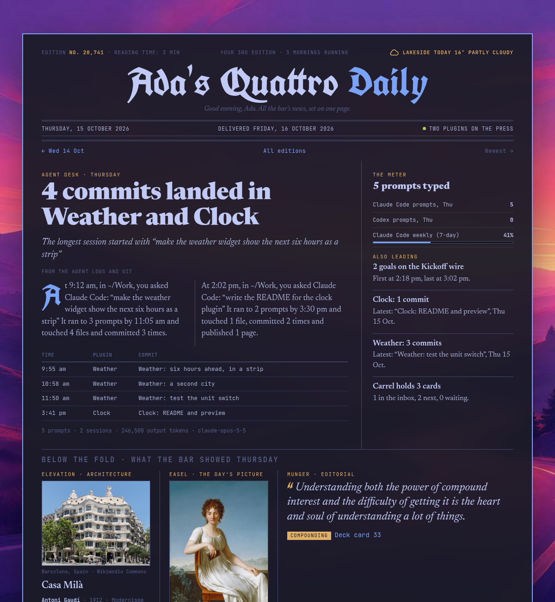

# Quattro Daily

A morning newspaper about yesterday on your machine. It's set from what actually happened there: the agent work you did, the commits that landed, the goals Kickoff called, the building, picture and line the bar dealt you, and the weather Isobar saw. It's laid on your own wallpaper in your theme's colours, one page you can read over coffee.

The masthead carries your first name, from your account's full name or else your user name: *Ada's Quattro Daily*. A folded paper sits on the bar, with a dot when there's an edition you haven't read.



## Features

- **The front page** — yesterday's stories, ranked. Your own work leads: agent sessions that shipped something, and plugin commits, weighted by what came of them rather than by tokens. Then whatever happened live on the bar, such as goals (followed clubs first). The daily picks only lead on a day when nothing else happened. Your agent work always stays above the fold.
- **The meter and the plugin desk** — prompts typed per agent, your usage limits, and short briefs on each plugin's latest commits and Carrel's cards.
- **Below the fold** — the day's building from Elevation (its photo fetched fresh from Wikimedia), Easel's picture with its wall label from the Art Institute of Chicago, and Munger's line.
- **Weather** — yesterday as Isobar saw it, with an hourly temperature line, rain, wind, sunrise and sunset, a two-day outlook, and the places you keep in Isobar: *Meanwhile in Tokyo: 69° and sunny*.
- **What's next** — today's building, picture and quote, before the bar shows them.
- **Your week in agents** — prompts typed per day for the last seven.
- **The back page** — a jumble made from the day's names, a keybinding you probably haven't used, an almanac (days on Omarchy, theme, wallpaper, free disk), and classifieds made of real loose ends: an expired sign-in, a plugin without a git repository, changes not yet committed.
- **Back issues** — every edition is kept. Each page links to the one before and after, there's an index of every masthead, and when you've had the paper a year, *A year ago today* turns up.
- **The Sunday magazine** — Saturday's news arrives on Sunday as *Quattro Sunday*, with your week in review: agent work and commits by day, the week's buildings, pictures and lines, and Kickoff's results.
- **Corrections** — the paper owns up. It holds yesterday's forecast against what happened (*We forecast a high of 61°; it reached 58°.*) and notes when a widget's cache served the wrong photo.

## Small things

- **Late edition.** If the paper is set again later and the news has changed, a red wax seal says so, with the time.
- **The weather ear.** The top corner of the masthead shows today's sky. On a rainy day it's an umbrella.
- **Reading time.** It's in the masthead, at an unhurried 230 words a minute.
- **Your Nth edition.** A streak counts the mornings you've had it.
- **Hang it.** A button under the day's picture swaps your wallpaper behind the page for the painting.
- **Print it.** It prints as a black-and-white tabloid broadsheet, with no window and no wallpaper.

Nothing is invented. A section with nothing to report says so, or stays out.

## Requirements

- Omarchy Quattro (Quickshell plugin support)
- `node`, `curl`, ImageMagick (`magick`) — all on a standard Omarchy install
- Network access for the building's photo, the picture's wall label and, if Isobar has no forecast cached, Open-Meteo (see [Privacy](#privacy))

Elevation, Easel, Munger, Kickoff, Isobar and Carrel are all optional. The paper reads whichever you have.

## Install

```bash
omarchy plugin add https://github.com/atsokolas/omarchy-daily-plugin.git --enable
```

The first edition is set at 5 am, or at your first unlock after that if the screen is locked. To set one now:

```bash
omarchy-shell atsokolas.daily build
```

## Keys

| Key | Action |
| --- | --- |
| `↑` `↓` | Choose an edition |
| `Return` | Read it in your browser |
| `i` | The index of every edition |
| `r` | Set yesterday's edition now |
| `g` | Back to the newest |
| `Esc` | Close |

On the bar: left click opens the panel, middle click opens the newest edition, and right click opens the index.

With The Front Page installed, its morning page gets a *Your paper* line under the masthead. Press `p` there to read it.

## Settings

| Setting | Default | Description |
| --- | --- | --- |
| `notify` | `true` | A toast when the paper arrives |
| `hour` | `5` | Yesterday's edition is set at this hour, or at the first unlock after it |
| `prose` | `false` | Asks Claude Code to rewrite the headlines from the facts |
| `web` | `false` | Puts each edition on claude.ai, at one private link that stays the same |

### Headlines by Claude

The paper is set by plain code, so the headlines say what happened rather than tell it well: *17 commits landed across seven plugins*. Turn on `prose`, and after each edition is set the builder runs `claude -p` with every fact on the page. It asks for new headlines, decks and a short summary of the agent desk, as JSON.

What comes back is checked before it's printed. A slot with a number that isn't in the facts is dropped, and so is anything too long or outside those slots. If Claude isn't installed or fails, the paper goes out with its own headlines. A line in the colophon says when Claude wrote them.

Claude runs in print mode with no tools and no MCP servers, from the paper's own folder, and is stopped after four minutes. It can only answer; nothing in the facts can get it to run a command or touch a file. It does need you signed in to Claude Code, and the facts it's sent include excerpts of your prompts, commit subjects and goal toasts. Leave `prose` off if those shouldn't leave the machine.

### The paper on the web

Turn on `web`, and after each edition is set the paper also goes up to claude.ai as a private artifact. It's the same link every morning, so you can keep it on your phone. The panel shows it as *On the web ↗*.

Only Claude Code can publish there, so the publisher starts a short background session with `claude --bg`. That session has three tools: Read, only inside the web copy's folder; Write, only on the one file it hands the link back in; and Artifact. Everything else is refused without asking, and it's stopped after eight minutes. Its prompt names the files and the link, never anything from the paper, and tells it that the page is data to publish, not instructions.

The web copy is the edition with its photos as files beside the page, and without the links to back issues, which stay on your machine.

Before the first run, Claude Code has to trust the paper's folder. Run `claude` once in `~/.local/share/quattro-daily` and accept. To publish by hand:

```bash
~/.config/omarchy/plugins/atsokolas.daily/bin/quattro-daily-publish
~/.config/omarchy/plugins/atsokolas.daily/bin/quattro-daily-publish --dry-run   # the web copy and the command, nothing sent
```

## IPC

```bash
omarchy-shell atsokolas.daily toggle    # the panel
omarchy-shell atsokolas.daily read      # the newest edition, in your browser
omarchy-shell atsokolas.daily build     # set yesterday's edition now
omarchy-shell atsokolas.daily latest    # path to the newest edition
omarchy-shell atsokolas.daily publish   # put the newest edition on claude.ai now
omarchy-shell atsokolas.daily web       # the claude.ai link
omarchy-shell atsokolas.daily status    # {"latest":"2026-10-14","unread":true,…}
```

The builder also runs on its own:

```bash
~/.config/omarchy/plugins/atsokolas.daily/bin/quattro-daily-build --date 2026-10-14
~/.config/omarchy/plugins/atsokolas.daily/bin/quattro-daily-build --print-prompt
```

## Data

- `~/.local/share/quattro-daily/editions/<date>.html` — each edition, self-contained, images included
- `~/.local/share/quattro-daily/editions/<date>.json` — what it reported and the next day's forecast, for corrections
- `~/.local/share/quattro-daily/editions/index.html` and `editions.json` — the bound volume
- `~/.local/share/quattro-daily/latest.html` — always the newest
- `~/.local/share/quattro-daily/web/` — the web copy, and `state.json` with its claude.ai link
- `~/.local/state/omarchy/daily/read` — the last edition you opened

It reads, but never writes: notification history, the widgets' caches and decks, `~/.claude/projects` and `~/.codex/sessions`, the agent usage meter, the git logs of every installed plugin (only commits under your own `git config user.email` count as yours), Carrel's board, Isobar's forecast cache and its settings in `~/.config/omarchy/shell.json`.

## Privacy

Every edition is set and kept on your machine. It quotes your prompts and commit subjects, so treat the editions folder as you would your shell history.

The builder talks to the network only for public data: Wikipedia for the building's summary and photo, the Art Institute of Chicago for the picture's wall label, and Open-Meteo for the weather when Isobar's cache doesn't reach the day. With no Isobar place on file, it asks wttr.in where your IP address is. Run by hand with `--offline`, the builder stays entirely local. The page itself loads its typefaces from Google Fonts when you open it.

With `prose` on, the facts on the front page are sent to Claude (see [Headlines by Claude](#headlines-by-claude)).

With `web` on, the whole edition goes to claude.ai as a private artifact on your account. It quotes your prompts and commit subjects, so think before you share its link.

## Tests

```bash
./tests/run
```

## License

MIT
